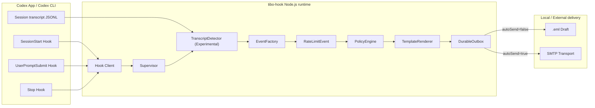
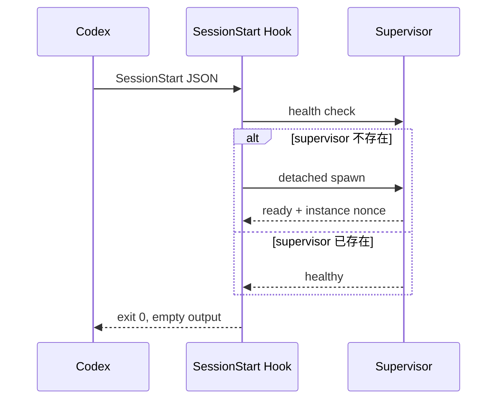
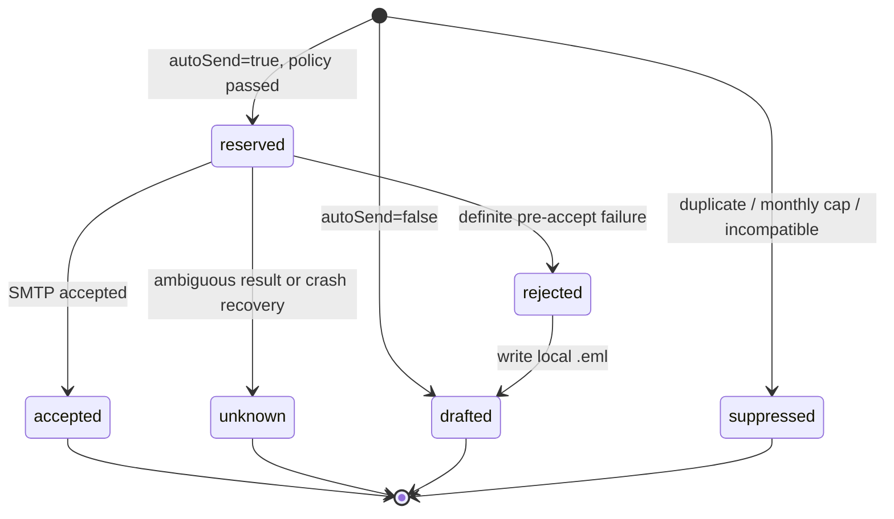
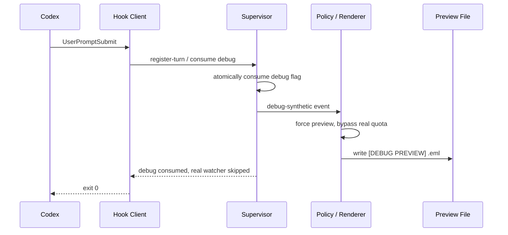

# tibo-hook 技术设计

> 状态：Proposed
> 对应产品规格：`SPEC.md`
> 实现目标：v0.1.0 Experimental
> 证据复核日期：2026-08-06

## 1. 设计边界

tibo-hook 分为两条独立链路：

1. **检测链路**：在 Codex 当前公开 Hook 能力之外，以受版本约束的 transcript watcher 确认 `usage_limit_exceeded`。
2. **邮件链路**：把已净化的 `RateLimitEvent` 经过策略、模板、outbox 后写成草稿或交给 SMTP。

检测链路可以被未来的原生错误 Hook 替换。策略、模板和邮件代码不依赖 transcript 格式。

设计优先级如下：

1. 不误发和不重复发送；
2. 不泄露会话内容与凭据；
3. 不改变 Codex turn 的执行结果；
4. 在上述约束内缩短检测与投递延迟。

## 2. 可行性基线

### 2.1 已验证事实

本设计以本机 `codex-cli 0.144.3`、固定的 Codex 源码快照 [`2e1607e`](https://github.com/openai/codex/tree/2e1607ee2fa8099a233df7437adee5f16a741905) 和当前公开文档为基线。源码快照用于解释机制，不宣称它就是 0.144.3 的精确 release commit；真正的兼容承诺必须由 0.144.3 fixture 与 App/CLI smoke test 建立。

| 事实 | 设计影响 | 证据 |
|---|---|---|
| 当前公开 Hook 没有 `TurnError`、`ModelError` 或 `RateLimit` | 不能直接订阅模型错误 | [Hooks](https://learn.chatgpt.com/docs/hooks)、[`HookEventName`](https://github.com/openai/codex/blob/2e1607ee2fa8099a233df7437adee5f16a741905/codex-rs/protocol/src/protocol.rs#L1491-L1504) |
| `Stop` 在模型正常完成且不再 follow-up 时运行 | 对本项目关心的模型/API 路径，`Stop` 只清理成功 turn | [`turn.rs`](https://github.com/openai/codex/blob/2e1607ee2fa8099a233df7437adee5f16a741905/codex-rs/core/src/session/turn.rs#L376-L384) |
| turn 错误发送 `ErrorEvent` 后直接退出，不运行 `Stop` | 额度失败不能依赖 `Stop` 捕获 | [`turn.rs`](https://github.com/openai/codex/blob/2e1607ee2fa8099a233df7437adee5f16a741905/codex-rs/core/src/session/turn.rs#L449-L458) |
| `PostToolUse` 只覆盖受支持的本地工具路径 | 模型请求返回不是 tool result | [Tool coverage](https://learn.chatgpt.com/docs/hooks#tool-coverage) |
| `UserPromptSubmit` 包含 `turn_id`，公共输入包含 `transcript_path` | 可在模型请求前注册 watcher | [UserPromptSubmit](https://learn.chatgpt.com/docs/hooks#userpromptsubmit) |
| transcript 格式不是稳定的 Hook 接口 | detector 必须版本门控和 fail closed | [Common input fields](https://learn.chatgpt.com/docs/hooks#common-input-fields) |
| 插件默认发现 `hooks/hooks.json`，并提供 `PLUGIN_ROOT`、`PLUGIN_DATA` | 代码与可写状态可以分离 | [Plugin-bundled hooks](https://learn.chatgpt.com/docs/hooks#plugin-bundled-hooks) |
| 插件 Hook 安装后仍需用户审核信任 | 安装流程必须包含 `/hooks` | [Review and trust hooks](https://learn.chatgpt.com/docs/hooks#review-and-trust-hooks) |

Codex 把 `UsageLimitReached`、`QuotaExceeded` 和 `UsageNotIncluded` 映射成同一个公开 `UsageLimitExceeded`。[源码映射](https://github.com/openai/codex/blob/2e1607ee2fa8099a233df7437adee5f16a741905/codex-rs/protocol/src/error.rs#L223-L230) 因此 v0.1.0 的准确承诺是“识别公开结构化 usage-limit 错误”，不是恢复服务端内部错误种类。

### 2.2 为什么不使用 OTel 作为主检测器

Codex OTel 文档列出 `codex.api_request`、`codex.sse_event` 和 WebSocket 事件，但它们是观测事件，不是插件错误 Hook。[Advanced configuration](https://learn.chatgpt.com/docs/config-file/config-advanced#observability-and-telemetry)

OTel 确实提供 HTTP status 与部分错误信号；问题不是“完全看不到 429”，而是它没有跨 HTTP、SSE 与 WebSocket 统一提供 `UsageLimitExceeded`、最终失败语义和 reset window。它不进入 v0.1.0 主链路，原因如下：

- HTTP transport error 在 OTel 中被压缩为 `http <status>`，不包含区分 `usage_limit_reached` 与普通 429 的响应体。[错误压缩](https://github.com/openai/codex/blob/2e1607ee2fa8099a233df7437adee5f16a741905/codex-rs/response-debug-context/src/lib.rs#L63-L69)
- 429 的 body/header 在 OTel 记录之后才被解析为 `UsageLimitReached`。[429 映射](https://github.com/openai/codex/blob/2e1607ee2fa8099a233df7437adee5f16a741905/codex-rs/codex-api/src/api_bridge.rs#L85-L117)
- SSE 可以先得到 HTTP 200，再在 `response.failed` 中出现额度错误；WebSocket 又使用另一组遥测事件。
- OTel 默认 opt-in、异步批量发送，而且只有一个 log exporter 配置。插件不能静默覆盖用户现有 exporter。

OTel 以后可以作为诊断候选信号，但在没有第二个结构化语义来源确认前，不能直接创建 `RateLimitEvent` 或触发邮件。

### 2.3 App Server 的位置

App Server 当前已经提供结构化能力，不是未来设想：失败 `turn/completed` 和 `error` 通知包含 `codexErrorInfo`，其中包括 `UsageLimitExceeded`；`account/rateLimits/read` 与 `account/rateLimits/updated` 还提供 `limitId`、`primary/secondary.resetsAt` 和 `rateLimitReachedType`。[App Server errors](https://learn.chatgpt.com/docs/app-server#errors) [Rate limits](https://learn.chatgpt.com/docs/app-server#6-rate-limits-chatgpt)

App Server 另有 `account/sendAddCreditsNudgeEmail`，语义是通知 workspace owner，不是向任意外部地址发送申请，因此不能替代本项目的 SMTP transport。[Auth endpoints](https://learn.chatgpt.com/docs/app-server#auth-endpoints)

插件无法旁路订阅宿主 Codex App 或既有 CLI 会话的 App Server 通知。单独启动另一个 `codex app-server` 只能观察由该进程承载的 turn，因此不用于 v0.1.0 的透明检测。

因此，自建 Codex client 或 wrapper 应优先实现 `AppServerDetector`，并可用 `account/rateLimits/read` enrichment 取得 reset window；marketplace plugin v0.1.0 不会为了 enrichment 另起 App Server，也不会声称由此观察到宿主 turn。两条路径都输出同一净化事件，策略和投递层不变。

## 3. 总体架构



### 3.1 组件职责

| 组件 | 职责 | 禁止行为 |
|---|---|---|
| Hook Client | 读取 stdin Hook JSON、确保 supervisor 可用、发送注册/清理消息 | 不等待模型完成，不读取 prompt 内容，不发送邮件 |
| Supervisor | 单例进程、watcher 生命周期、单写者状态、策略与投递调度 | 不监听公网，不修改 Codex 配置 |
| TranscriptDetector | 从注册 offset 开始读取新增 JSONL，输出净化事件 | 不按错误文案猜测，不持久化 transcript 内容 |
| EventFactory | 用当前配置身份与安装密钥完成 `eventId/windowKey` | 不读取模板正文，不执行投递策略 |
| PolicyEngine | 版本检查、窗口去重、滚动上限和 debug 强制规则 | 不允许配置突破 3 封硬上限 |
| TemplateRenderer | 读取用户模板并替换白名单变量 | 不执行代码、include、环境变量或递归模板 |
| DurableOutbox | 先持久化 reservation，再控制草稿或 SMTP 状态机 | 不在不明确结果后自动重试 |
| SMTP Transport | 构造纯文本邮件并完成 TLS SMTP 会话 | 不支持明文 SMTP、CC/BCC、任意 relay |

## 4. 计划中的仓库布局

本次只交付 `SPEC.md` 与 `DESIGN.md`。实现阶段采用以下布局：

```text
tibo-hook/
├── .agents/
│   └── plugins/
│       └── marketplace.json
├── plugins/
│   └── tibo-hook/
│       ├── .codex-plugin/
│       │   └── plugin.json
│       ├── hooks/
│       │   └── hooks.json
│       ├── skills/
│       │   └── tibo-hook-setup/
│       │       └── SKILL.md
│       ├── dist/
│       │   └── tibo-hook.cjs
│       ├── templates/
│       │   └── request.txt
│       └── compatibility.json
├── src/
├── tests/
│   └── fixtures/
│       └── transcripts/
├── SPEC.md
├── DESIGN.md
├── package.json
├── tsconfig.json
└── LICENSE
```

`.agents/plugins/marketplace.json` 中的 plugin source 固定为 `./plugins/tibo-hook`。插件 manifest 不声明冗余 `hooks` 字段，使用 Codex 自动发现的 `hooks/hooks.json`。这同时减少 manifest 与 Hook 路径的双重配置。[Plugin structure](https://developers.openai.com/plugins/build/plugins#plugin-structure)

根 `package.json` 同时发布可选 companion npm CLI，`bin.tibo-hook` 直接指向 `plugins/tibo-hook/dist/tibo-hook.cjs`。Marketplace plugin 与 npm 包必须来自同一 release、共享 bundle checksum 和版本号；npm 包不是第二套 runtime。

## 5. 构建与运行时

### 5.1 技术栈

| 项目 | 决定 |
|---|---|
| 语言 | TypeScript，`strict=true` |
| 最低运行时 | Node.js 20 |
| 产物 | esbuild 生成单个 `dist/tibo-hook.cjs` |
| SMTP | Nodemailer，打包进单文件产物 |
| 状态 | 自有 append-only journal + snapshot；无原生 SQLite 依赖 |
| 测试 | Node test runner 或 Vitest，fake clock，Mailpit/本地 SMTP fixture |

所有生产依赖必须被 bundle。安装插件后不执行 `npm install` 或生命周期脚本。运行时不得下载代码或模板。

Marketplace 安装不会把自定义 binary 放入 `PATH`。公共管理动作有两个载体：

1. bundled `tibo-hook-setup` skill 调用 plugin 内 bundle；
2. 可选安装 `@zxdxjtu/tibo-hook` 后，由 `bin.tibo-hook` 暴露裸 CLI。

Hook runtime 总是使用 Codex 注入的 `PLUGIN_DATA`。companion CLI 按以下顺序解析相同数据目录：显式 `TIBO_HOOK_PLUGIN_DATA`；否则读取 `CODEX_HOME` 并按经过 0.144.3 smoke test 的 plugin ID `tibo-hook@tibo-hook` 定位，同时用 `codex plugin list --marketplace tibo-hook --json` 验证插件已安装、启用且版本与 CLI 完全相同。任一条件不成立或候选不唯一时退出 3，不猜测路径。`config path` 输出最终目录，便于用户核对。该 locator 属于 surface adapter；`${PLUGIN_DATA}/config.json` 的业务契约不变。

### 5.2 Hook 命令

`hooks/hooks.json` 注册 `SessionStart`、`UserPromptSubmit` 和 `Stop`。每个 Hook 使用同步 `type: "command"`，声明 `timeout: 5`，因为当前 `async` 字段虽可解析但不会执行异步 command Hook。[Hook config shape](https://learn.chatgpt.com/docs/hooks#config-shape)

POSIX 命令形态：

```text
node "${PLUGIN_ROOT}/dist/tibo-hook.cjs" hook <event-name>
```

Windows `commandWindows`：

```text
node "%PLUGIN_ROOT%\dist\tibo-hook.cjs" hook <event-name>
```

Hook Client 的标准行为：

- stdin 最多接受 16 MiB JSON；parser 只投影 Hook 元数据并立即丢弃可能很大的 `prompt` 字段，超限时写脱敏诊断后退出 0。
- 成功时 stdout/stderr 为空并退出 0。
- 内部配置、兼容性或 watcher 错误均记录本地诊断并退出 0，不改变 Codex turn。
- supervisor 注册必须在 Hook timeout 内确认；默认内部 deadline 为 2 秒。
- 不返回 `additionalContext`、`decision`、`continue` 或其他会影响模型流程的字段。

## 6. Hook 与 watcher 生命周期

### 6.1 SessionStart



SessionStart 只负责启动和健康检查，不注册 detector，也不读 transcript。

### 6.2 UserPromptSubmit

Hook Client 必须忽略输入中的 `prompt` 字段。处理步骤：

1. 校验 `session_id`、`turn_id`、`transcript_path`、`model`。
2. 以不跟随 symlink 的只读方式打开 transcript，读取且只读取首条完整 `session_meta`，投影 `cli_version/source/originator` 后立即丢弃原对象。
3. 在同一 open handle 上取得 canonical path、文件 identity 和当前 byte length，作为 `startOffset`。
4. 确保 supervisor 健康。
5. 发送 `register-turn` 消息。
6. supervisor 把 registration 持久化后返回 ACK。
7. Hook Client 空输出并退出 0。

首条 metadata line 上限为 16 MiB；缺失、超限、非法或不是兼容 `session_meta` 时不注册。该受限 preflight 是唯一允许读取 EOF 之前内容的路径，不扫描任何历史 `event_msg`。

同一 session 同时只允许一个活动的 root turn。新的 `UserPromptSubmit` 到达时，旧 registration 先标记为 `superseded`，再注册新 turn。Codex 当前按 session 串行执行 root turn；若未来允许并发 root turn，兼容测试必须先更新该约束。

### 6.3 Stop

Stop Hook 发送 `complete-turn`。supervisor 核对 session/turn 后：

- 停止对应 watcher；
- 删除活动 registration；
- 记录 `completed_without_limit` 诊断计数；
- 不创建 `RateLimitEvent`。

429 等失败路径不会运行 Stop，watcher 必须自己从错误记录结束。

### 6.4 无 Stop 的清理

watcher 在以下情况结束：

- 发现目标 `usage_limit_exceeded`；
- 发现其他 terminal error；
- transcript 被替换、截断或变成非普通文件；
- registration 被新 turn 取代；
- supervisor 关闭；
- registration 超过 6 小时。

6 小时属于资源保护上限，不作为业务可配置项。超时后只写脱敏诊断。

## 7. Supervisor 与本地 IPC

### 7.1 单例

Supervisor 以原子创建 `${PLUGIN_DATA}/state/supervisor.lock/` 目录作为 leader election；目录内 metadata 包含 PID、随机 instance nonce、build ID、启动时间和 heartbeat。Hook Client 使用 `child_process.spawn(process.execPath, [bundle, "supervisor"], { detached: true, stdio: "ignore" })` 启动后等待 ready，再 `unref()`。

Hook Client 不只检查 PID：它必须向 IPC 端点发送 nonce challenge 并收到当前进程签名响应，避免 PID 复用或陈旧 lock 被误判为健康实例。

只有 IPC 不可达、heartbeat 超过 2 分钟且 PID 已确认不存在三个条件同时成立，竞争者才可用原子 rename 抢占并清理 stale lock；条件不能全部证明时不启动第二个 writer，当前 Hook fail-open、邮件侧 fail-closed。

握手同时比较 `protocolVersion`、plugin version 与 bundle build ID。升级后若旧 supervisor 仍有 watcher，新 Hook 不向它注册新 turn，也不并行启动第二个 writer；旧实例在 watcher 结束或 6 小时上限后退出，再由新 bundle 接管。

### 7.2 IPC

- macOS/Linux：在 `os.tmpdir()` 下创建 `tibo-hook-<uid>-<data-path-hash>/supervisor.sock`，父目录 `0700`、socket `0600`；短 hash 避免 Unix socket path-length 限制。
- Windows：`\\.\pipe\tibo-hook-<install-id>` named pipe，DACL 只允许当前用户和系统账号。
- 不使用 TCP loopback，避免端口冲突和意外网络暴露。
- 每条消息为单行 JSON，最大 64 KiB，包含 `protocolVersion: 1`、nonce、request ID 和 HMAC。
- 两个平台都使用 `${PLUGIN_DATA}/state/ipc.key` 验证消息 HMAC。`ipc.key` 由 `init` 生成 32-byte 随机值，权限 `0600`，不得进入日志；Unix 临时目录或 pipe name 本身都不作为认证凭据。

### 7.3 单写者规则

只有 supervisor 可以写 journal、snapshot、draft 和 delivery 状态。Hook Client 只能通过 IPC 请求变更。该规则把同一机器上多个 Codex App/CLI session 的并发收敛到单一顺序状态机。

## 8. TranscriptDetector

### 8.1 Registration

```ts
type TurnRegistration = {
  protocolVersion: 1;
  sessionId: string;
  turnId: string;
  transcriptPath: string;
  fileIdentity: string;
  startOffset: number;
  model: string;
  codexVersion: string;
  surface: "codex-app" | "codex-cli";
  registeredAt: string;
};
```

`fileIdentity` 在 POSIX 使用 device/inode；Windows 使用 canonical path、size、creation time 和稳定文件标识的可用组合。身份无法建立时不注册。

### 8.2 增量读取

- 除 registration 的首条 `session_meta` preflight 外，只从 `startOffset` 读取，不扫描 offset 之前的历史错误。
- 使用 64 KiB chunk，并保留最后一个未换行 partial buffer。
- `fs.watch` 只作低延迟唤醒提示；共享 scheduler 至少每 500 ms 用 `stat/read` 校验 offset，正确性不依赖平台可能丢失或合并的文件通知。
- 单行安全上限为 16 MiB；超过时关闭该 watcher。
- 只在读取到换行后解析完整 JSON。
- 文件 size 小于已提交 offset、identity 变化或 canonical path 变化都视为 schema/source 不可信，立即 fail closed。
- JSON 解析对象只在内存中短暂存在；非候选记录处理后立即释放，不写 journal 或日志。

### 8.3 允许读取的记录

Parser 只保留以下白名单元数据：

| 记录 | 字段 | 用途 |
|---|---|---|
| 首条 `session_meta` | `cli_version`、`source`、`originator` | registration preflight 的兼容版本和 surface |
| token/rate-limit snapshot | `limit_id`、`rate_limit_reached_type`、结构化 `resets_at` | `limitKind` 与 reset window |
| `event_msg` error | `payload.type`、`payload.codex_error_info`、时间戳 | 唯一真实错误判据 |
| 兼容清单中的 terminal lifecycle | event type、`turn_id` | `turn_aborted/turn_complete` 等只用于关闭 watcher |

不得把 `message` 字段作为判据或复制到下游。prompt、assistant、reasoning、tool output 和文件内容一律丢弃。

兼容基线中的 Error payload 只有 `message` 与 `codex_error_info`，没有 `turnId`、HTTP status、`limitKind` 或 `resetAt`。[`ErrorEvent`](https://github.com/openai/codex/blob/2e1607ee2fa8099a233df7437adee5f16a741905/codex-rs/protocol/src/protocol.rs#L1911-L1915) `turnId` 必须取自本次 `UserPromptSubmit` registration，不能从 Error record 补造。`usage_limit_exceeded` 是 snake_case wire value，[`CodexErrorInfo`](https://github.com/openai/codex/blob/2e1607ee2fa8099a233df7437adee5f16a741905/codex-rs/protocol/src/protocol.rs#L1746-L1754) 证明的是 Codex 的公开语义错误分类；由于多个内部错误会映射到该分类，它不等价于证明服务端原始响应一定是某一种 HTTP 429。

`occurredAt` 只取目标 record 外层的合法 RFC 3339 timestamp 并规范化为 UTC；缺失或无效时不输出候选。`model` 只取 Hook registration 的非空值。

`token_count.rate_limits` 只可用于 enrichment：必须位于 registration 的 `startOffset` 之后、目标 Error 之前，并通过当前版本 fixture 的完整字段校验。兼容基线会在 `UsageLimitReached` 含 snapshot 时先更新并发送 token-count event，再向上返回错误。[snapshot 更新路径](https://github.com/openai/codex/blob/2e1607ee2fa8099a233df7437adee5f16a741905/codex-rs/core/src/session/turn.rs#L1181-L1185)

`rate_limit_reached_type` 非空时成为 `limitKind`。v0.1.0 只在 kind 为 `rate_limit_reached`，且恰好一个 `used_percent >= 100` 的 primary/secondary window 提供合法未来 `resets_at`，或多个候选给出相同时间时采用 `resetAt`；workspace credits/usage-limit kind 与窗口的关联不明确，固定置为 null。其他情况也一律进入 UTC 24 小时 fallback，不选择“看起来最可能”的窗口。

### 8.4 判定算法

```text
if codexVersion not in compatibility manifest:
    diagnostic(unsupported_version); stop watcher

for each complete appended record:
    validate envelope
    update structured rate-limit metadata when present

    if record is a validated non-error terminal event for registered turn:
        close watcher without an event
        continue

    if record.type != event_msg:
        continue
    if payload.type != error:
        continue
    if payload.codex_error_info != usage_limit_exceeded:
        close watcher as non_target_error
        continue

    enrich only from an unambiguous in-range structured snapshot
    create sanitized RateLimitEvent using the registered turnId
    close watcher
    submit event to PolicyEngine
```

文本 `429`、`Too Many Requests`、`quota` 或其他关键字永远不进入判定算法。

### 8.5 Surface 与版本

- `codexVersion` 来自结构化 `session_meta.cli_version`，不能从命令输出或错误文本猜测。
- `surface` 只依据兼容 fixture 中明确映射的 `source/originator` 值。
- 未知值映射为 `unknown`；真实 transcript detector 立即记录诊断并关闭 watcher，不生成草稿或连接 SMTP。`unknown` 只保留给 debug、preview 或尚未纳入 plugin 支持面的其他 detector。
- 自动发送要求 `codexVersion` 精确命中 `compatibility.json` 且该版本 entry 的 `autoSend=true`。

## 9. Detector 抽象

```ts
interface Detector {
  readonly id: "transcript-experimental" | "app-server" | "turn-error-native";
  readonly maturity: "experimental" | "stable";
  register(input: DetectorRegistration): Promise<void>;
  complete(sessionId: string, turnId: string): Promise<void>;
}
```

Detector 只能输出私有的 `DetectedRateLimit`：它等于 schema v1 `RateLimitEvent` 去掉 `eventId` 与 `windowKey`，且同样禁止正文、路径和凭据。`EventFactory` 使用一次原子读取并严格校验的 config snapshot 补全这两个字段；PolicyEngine 不接收原始 transcript 或 Hook input。

适配器优先级固定为：

1. 公开 `turn-error-native` Hook 可用时使用原生 Hook 适配器；
2. 对由集成方自己启动并承载 turn 的 App Server client，使用当前可用的 `app-server` 适配器；
3. 对无法订阅宿主 App/CLI App Server 的 marketplace plugin，仅在兼容清单允许时使用 `transcript-experimental`；
4. 没有适用 detector 时禁用真实检测，保留 debug 与 CLI 预览。

同一 turn 不允许两个 detector 同时提交候选。`eventId` 与 window reservation 仍作为最后一道去重。

## 10. RateLimitEvent 净化

```ts
type RateLimitEvent = {
  schemaVersion: 1;
  eventId: string;
  sessionId: string;
  turnId: string;
  occurredAt: string;
  surface: "codex-app" | "codex-cli" | "unknown";
  model: string;
  codexVersion: string;
  errorCode: "usage_limit_exceeded";
  limitKind: string | null;
  resetAt: string | null;
  windowKey: string;
  detector: "transcript-experimental" | "debug-synthetic" | "app-server" | "turn-error-native";
};
```

EventFactory 在 supervisor 的单写者队列中运行。`init` 生成 `${PLUGIN_DATA}/state/install.key`，内容为 32-byte 随机值；supervisor 只校验并使用，不负责缺失时重建。所有写入日志或状态的标识符使用 HMAC-SHA-256：

```text
eventId = HMAC(installKey, "event-v1" || sessionId || turnId || occurredAt || errorCode)
windowKey = HMAC(installKey, "window-v1" || normalizedUser || normalizedRecipient || limitKind || resetAtOrUtcBucket)
installScope = HMAC(installKey, "rolling-v1")
```

所有 HMAC 输入使用确定性的长度前缀 UTF-8 tuple 编码，上述 `||` 只表示字段边界，不表示直接拼接。使用带本地秘密的 HMAC，而不是直接对低熵邮箱做无盐哈希。`install.key` 丢失或损坏时必须禁用自动发送；不得静默生成新 key 并清空去重边界。

邮箱 normalization：去除首尾空白、Unicode NFC、整个地址转小写。该 normalization 只用于本地策略 key，不改变实际邮件头。

## 11. PolicyEngine

处理顺序固定为：

1. Pipeline coordinator 检查 detector、Codex 版本、surface 和候选 schema。
2. 原子读取并严格校验最新 config snapshot。
3. EventFactory 计算 `eventId`、`windowKey` 和安装级 `installScope`，输出 `RateLimitEvent`。
4. PolicyEngine 读取并校验模板。
5. 查询同窗口状态。
6. 以 supervisor 当前 UTC 时间为决策时刻，查询本安装此前连续 30×24 小时内按原始 `reservedAt` 计数的 `reserved/accepted/unknown`；配置变更不能创建新 scope。
7. debug 事件强制进入 preview 分支，不执行第 5、6 步的配额占用。
8. 草稿模式创建 draft reservation。
9. 自动模式先持久化 `reserved`，然后才允许 SMTP 连接。

如果结构化 `resetAt` 存在，按 UTC RFC 3339 秒级规范化。否则 fallback bucket 为 `floor(occurredAt / 24h UTC)`。

配置里的 `maxPerRolling30Days` 允许 1–3。实现中另有不可配置的硬上限 3；即使配置 parser 出错或字段缺失，也不能提高该值。

## 12. TemplateRenderer

### 12.1 路径

1. `templatePath` 必须是相对路径。
2. 对 `${PLUGIN_DATA}` 与目标做 `realpath`。
3. 目标必须是普通文件，且 canonical path 位于 canonical `PLUGIN_DATA` 内。
4. 拒绝 `..`、绝对路径、symlink/reparse-point escape。
5. 只从已验证的只读 handle 读取；read 前后的 file identity、size 与 canonical containment 必须一致，否则丢弃本次内容并阻止发送。

### 12.2 语法

- 只识别 `{{identifier}}`。
- identifier 必须在 `SPEC.md` 白名单中。
- 未闭合占位符、未知 identifier 或缺失必填值直接失败。
- 变量值执行单次纯文本替换；值中的 `{{...}}` 不再解析。
- 不支持 Handlebars/Mustache 的条件、循环、helper 或 include。
- 模板文件与渲染正文均不超过 10 KiB UTF-8。
- 渲染后 subject 不超过 200 个 Unicode code point；subject 与邮箱头拒绝 CR、LF、NUL 和其他控制字符。
- 正文输入允许 LF 与 TAB，拒绝 CR、NUL 和其他控制字符；MIME serializer 最后统一生成 RFC 5322 CRLF。

Renderer 接口：

```ts
type RenderedMail = {
  envelope: { from: string; to: string };
  headers: {
    from: string;
    to: string;
    replyTo: string;
    subject: string;
    messageId: string;
    date: string;
  };
  text: string;
  contentHash: string;
};
```

`contentHash` 只用于本地完整性检查，不写日志。邮件固定为 `text/plain; charset=utf-8`。

## 13. DurableOutbox

### 13.1 文件

```text
${PLUGIN_DATA}/
├── config.json
├── templates/request.txt
├── drafts/
├── previews/
├── outbox/
├── logs/diagnostic.ndjson
└── state/
    ├── install.key
    ├── ipc.key
    ├── supervisor.lock/
    ├── journal-<generation>.ndjson
    └── snapshot-<sequence>.json
```

journal 只记录净化后的 key、状态、时间、错误类别和版本，不记录邮件正文、邮箱或 transcript 路径。

POSIX 上所有目录为 `0700`、所有普通文件为 `0600`。Windows 使用仅授予当前用户和系统账号的 ACL；若无法证明 data directory 不可被其他用户写入，则禁用自动发送。

### 13.2 Journal

- 每条记录包含单调 `sequence`、`previousHash`、operation、净化 data 与当前 canonical JSON 的 SHA-256 `hash`；每次状态转换以单行 JSON append。
- append 后 `fsync`，返回成功后才能进行下一副作用。
- 每 100 条记录或正常 idle shutdown 时生成 snapshot。
- snapshot 包含最后 `sequence/hash` 和完整 policy state；写入临时文件、`fsync`、原子 rename，POSIX 上再 `fsync` 父目录。
- snapshot 成功后开启引用该 snapshot 的新 journal segment；新 segment 持久化成功前不删除旧 generation。
- 启动时选择 sequence 最高且 hash chain 完整的一组 snapshot + segment，再 replay 后续 journal。
- 只允许忽略崩溃造成的末尾不完整 JSONL；中间损坏、sequence/hash 断裂或非法状态转换使自动发送 fail closed。

### 13.3 状态机



`reserved` 必须先落盘，再创建 DNS/TCP/TLS 连接。启动恢复时，遗留 `reserved` 一律转为 `unknown`，不重试。

自动发送的落盘顺序固定为：

1. 把最终 RFC 822 内容写入 `outbox/<eventId>.eml.tmp`，`fsync` 后原子 rename 为 `.eml`；
2. append 并 `fsync` `reserved`；
3. 从该 spool 执行唯一一次 SMTP attempt；
4. append 并 `fsync` terminal state；
5. `accepted/unknown` 删除 spool；`rejected` 把 spool 原子移动到 `drafts/`，随后 append `drafted` 并保留 `smtp_rejected` reason。journal history 仍能证明曾明确拒绝。

启动时，journal 中仍为 `reserved` 的 spool 转为 `unknown` 后删除；已记录 `rejected` 且 spool 仍存在时只恢复本地 draft move；没有 reservation 的孤儿 `.tmp/.eml` 可直接删除。恢复流程绝不连接网络，这样任何崩溃点都不会产生第二次 SMTP attempt。

### 13.4 草稿

- 文件名：`<UTC compact timestamp>-<eventId first 12 chars>.eml`。
- 使用 `O_CREAT|O_EXCL` 防止覆盖。
- 临时文件写入、`fsync` 后原子 rename。
- 权限 `0600`，目录 `0700`。
- 每次正常启动清理 30 天前的草稿；不跟随 symlink。
- `preview` 和 debug 文件写入 `previews/`，文件名带 `preview-` 或 `debug-` 前缀，不进入 window ledger，并与草稿一样在 30 天后清理。

### 13.5 安全诊断日志

`diagnostic.ndjson` 每条记录只允许包含时间、HMAC 后的 `eventId`、delivery state、Codex 版本、surface 和有限枚举 `errorCategory`。第三方异常必须先映射为 `config_invalid`、`schema_drift`、`smtp_tls`、`smtp_auth`、`smtp_timeout` 等类别，不能直接序列化 error object。

日志禁止包含邮件正文或主题、完整邮箱、SMTP username/password、transcript 路径或 record、session/turn 原始 ID、prompt、assistant 内容和完整错误文本。单文件上限 1 MiB，最多保留三个 generation；轮转删除是 best effort，不影响策略正确性。

`.eml` 是用户要求的实际邮件，因此必然包含配置中的 `To`、`From`、`Reply-To`，默认模板还包含 `userEmail`。隐私测试对 `.eml` 的正确断言是：只允许这三个配置地址，不得出现任何来自 transcript 或凭据的地址；“完整邮箱必须脱敏”的要求只适用于日志、journal、snapshot 和 CLI status。

## 14. SMTP Transport

### 14.1 身份

- Envelope From 与 `From` 使用 `smtp.fromEmail`。
- `Reply-To` 使用 `userEmail`。
- `To` 只使用 `tiboEmail`。
- `requesterName` 可以作为 `From` display name，但不能替代已验证 sender address。
- 不生成 CC、BCC、附件、HTML、读取回执或跟踪内容。

### 14.2 TLS 与认证

Nodemailer transport 配置固定映射：

| 配置 | Nodemailer 行为 |
|---|---|
| 587 + `starttls-required` | `secure=false`、`requireTLS=true` |
| 465 + `implicit-tls` | `secure=true` |

两种模式都设置：

- `tls.rejectUnauthorized=true`；
- `tls.servername=smtp.host`；
- TLS 最低版本 1.2；
- 整个 SMTP attempt 使用 `smtp.timeoutMs` 的绝对 deadline，connection、greeting、socket timeout 也分别不超过该值；
- `pool=false`；
- 不启用应用级自动重试。

`passwordEnv` 必须匹配 `[A-Za-z_][A-Za-z0-9_]*`。密码只从 `process.env[passwordEnv]` 读取；读取后不得放入长期对象、错误上下文、journal 或日志。

supervisor 只继承启动时环境。companion CLI 的 self-test 成功不能证明 Codex App 启动的 supervisor 拥有同一变量；`validate/status` 通过 IPC 返回布尔 preflight 类别，不返回变量值。环境变量变化要求重启 supervisor。

### 14.3 结果分类

Transport 在状态中跟踪 SMTP 阶段：`dns/connect/tls/auth/mail-from/rcpt-to/data/accepted`。

- `accepted`：服务器返回最终成功响应。
- `rejected`：在最终 DATA 接受前收到明确拒绝或确认未提交。
- `unknown`：进入 DATA 后发生超时、断线、进程崩溃，或依赖库没有足够信息证明未接受。

不能可靠分类时选择 `unknown`。`unknown` 与 `accepted` 同样占用窗口和月度上限。

## 15. Debug 链路

`debug-next` 在 supervisor 的单写者事务中把 `triggerNextPrompt` 设置为 `true`。

当下一次 `UserPromptSubmit` 消费该标志时，supervisor 必须先用临时文件、`fsync` 与原子 rename 把配置复位为 `false`；复位失败则不生成 preview。消费成功后不为该 prompt 创建真实 transcript watcher，因此即使这个测试 prompt 恰好遇到真实额度错误，tibo-hook 也不会连接 SMTP 或占用真实窗口。

下一次 `UserPromptSubmit` 的顺序是：



Debug 分支在构造 transport 前返回，测试通过 fake network assertion 证明 DNS/TCP/TLS 调用次数为零。preview 的逻辑收件人显示为 `userEmail`，不会使用 `tiboEmail`。

`smtp-test --to-self` 是独立的显式路径：即使 `autoSend=false` 也可运行，但必须重新执行完整 SMTP、TLS 与 sender preflight；envelope recipient 和 `To` 在 runtime 内强制设置为 `userEmail`，命令行不接受任意 `--to` 覆盖，且使用固定 self-test 文本而非申请模板。

## 16. 配置加载与热更新

- supervisor 不缓存跨事件的业务配置或模板正文。
- 每个候选由 pipeline coordinator 重新打开、解析和校验 `config.json`；EventFactory 与 PolicyEngine 共享这一不可变 snapshot。模板在 PolicyEngine 中按事件重新读取。
- `config.json` 必须是 `${PLUGIN_DATA}` 内不经 symlink/reparse point 的普通文件，并使用与模板相同的 handle/identity TOCTOU 检查。
- schema 使用 `additionalProperties: false`，拼写错误不被忽略。
- 配置文件读取采用单次 size/stat/read/stat；前后 identity 或 size 变化时本次处理失败。
- CLI 或 supervisor 更新 debug flag 时，以读入内容 hash 作为 compare-and-swap 前提，再通过临时文件、`fsync`、rename 写回；检测到并发手工编辑时放弃本次更新，不覆盖用户内容。
- 用户应通过 CLI 的原子写操作更新 debug flag；手工编辑时出现短暂无效 JSON 只导致当前事件 fail closed。
- `autoSend` 从 false 改为 true 不追溯发送历史草稿。

## 17. 兼容性管理

`plugins/tibo-hook/compatibility.json` 示例：

```json
{
  "schemaVersion": 1,
  "transcriptDetector": {
    "0.144.3": {
      "fixtureSchema": "rollout-v1",
      "surfaces": ["codex-app", "codex-cli"],
      "autoSend": true
    }
  }
}
```

规则：

- 只接受精确版本，不接受未经验证的 `0.144.x` 通配符。
- 每增加版本，必须加入脱敏 fixture、parser 测试和 App/CLI smoke evidence。
- 新版本保持相同字段也不能只凭肉眼比较直接开放自动发送。
- 未知版本保留 `init/validate/preview/debug-next/smtp-test --to-self/status`，禁用真实 detector。
- 发布说明列出精确兼容版本与最后验证表面。

官方文档可能先于本地稳定发行版列出新 Hook（例如手册与 0.144.3 事件枚举存在版本差异）。实现以运行版本的生成 schema 和兼容 fixture 为准，不能依赖文档 `main` 分支中尚未发布的字段。[Hook schemas](https://learn.chatgpt.com/docs/hooks#schemas)

## 18. 失败模式

| 失败 | 行为 | 是否允许 SMTP |
|---|---|---:|
| Node 不在 `PATH` | Codex 报告 Hook 命令失败；doctor 提示前置条件 | 否 |
| Hook 尚未信任 | Codex 跳过 Hook；status/doctor 提示 | 否 |
| 尚未 `init` 或 key 缺失/损坏 | 不启动真实 detector；提示运行 init/人工恢复 | 否 |
| supervisor 启动或 IPC 失败 | Hook 安静退出，写本地可用诊断 | 否 |
| transcript 为 null/缺失 | 不注册真实 detector | 否 |
| transcript 截断、替换或 schema drift | 关闭 watcher，记录分类诊断 | 否 |
| Codex 版本未知 | 禁用真实 detector | 否 |
| 配置或模板无效 | 不创建 reservation | 否 |
| password env 缺失 | 自动模式退回草稿并记录 preflight 失败 | 否 |
| journal 中间损坏 | 禁用自动发送，等待人工修复 | 否 |
| 同一窗口重复 | `suppressed: duplicate_window` | 否 |
| 30 天达到 3 次 | `suppressed: rolling_limit` | 否 |
| SMTP 明确拒绝 | `rejected`，生成本地草稿 | 已尝试一次 |
| SMTP 结果不明 | `unknown`，不重试 | 已尝试一次 |
| supervisor 在 SMTP 中崩溃 | 启动恢复时 `reserved → unknown` | 不再尝试 |

## 19. Detector 演进

### 19.1 当前 App Server adapter

`AppServerDetector` 面向自建 client/wrapper，而不是透明 marketplace plugin。它消费当前 App Server 的 `error` 与 failed `turn/completed`，只有 `codexErrorInfo` 为 `UsageLimitExceeded`（v2 wire 为 `"usageLimitExceeded"`）且事件已是 terminal failure 时才输出候选；retrying error 不产生副作用。候选的 `sessionId=threadId`，`turnId` 来自通知本身。

同一 App Server connection 可在 terminal error 后调用 `account/rateLimits/read`。只接受 server-classified reached bucket，并从对应 `primary/secondary.resetsAt` 取得无歧义窗口；读失败、bucket 不唯一或字段缺失时仍使用 `resetAt=null` 的 UTC 24 小时 fallback。enrichment 不能把普通 `HttpConnectionFailed` 429 升格为额度事件。

该 adapter 的验收前提是集成方拥有承载 turn 的 App Server connection。v0.1.0 plugin 不连接宿主未公开的 socket，不启动影子 App Server，不把账户 snapshot 单独当作触发器。

### 19.2 建议上游原生 TurnError Hook

项目向 Codex 上游建议增加 terminal error Hook。最小输入：

```json
{
  "session_id": "session-id",
  "transcript_path": null,
  "cwd": "/workspace",
  "hook_event_name": "TurnError",
  "model": "gpt-5.6",
  "turn_id": "turn-id",
  "error_code": "usage_limit_exceeded",
  "http_status_code": 429,
  "will_retry": false,
  "reset_at": "2026-08-06T10:00:00Z",
  "limit_kind": "codex"
}
```

契约要求：

- 只在 turn 已确定失败时运行，`will_retry=false` 才允许外部副作用。
- `error_code` 使用稳定枚举，不要求插件解析消息。
- `http_status_code`、`reset_at`、`limit_kind` 可为 null。
- 不默认携带 prompt、assistant 内容或完整服务端错误正文。
- App、CLI 与非交互表面使用相同 schema。

原生 Hook 可用后，`TurnErrorDetector` 构造同一 `DetectedRateLimit` 候选，再由 EventFactory 完成 `RateLimitEvent`；supervisor、PolicyEngine、Renderer、Outbox 和 SMTP 不变。发布迁移顺序为：先双 detector fixture 对照但只允许原生适配器产生候选，确认后删除 transcript 默认路径。

## 20. 测试设计

### 20.1 Parser 与 Hook

- Codex 0.144.3 的脱敏 `session_meta`、rate-limit snapshot 和 `usage_limit_exceeded` fixture。
- 普通 429 文本、retry limit、server overload、工具错误和成功 Stop。
- `turn_aborted/turn_complete` 等兼容 terminal record 只清理 watcher，不触发。
- EOF 之前的历史错误、partial line、多记录同 chunk、16 MiB 上限。
- 文件 truncate、replace、symlink、identity 变化和未知 schema。
- Hook stdin 超限、无 `turn_id`、无 transcript、错误 event name。
- `command` 与 `commandWindows` 参数引用测试。

测试只覆盖会影响“是否发送、发送几次、发送什么”的分支，不穷举所有错误文案。

### 20.2 Policy 与持久化

- fake clock 下结构化 reset window 与 UTC 24 小时 fallback。
- 同窗口串行、并发和跨重启重复事件。
- 不同用户邮箱、收件人或 SMTP 身份仍受同一安装级 30 天硬上限。
- accepted/unknown/reserved 计数，rejected/drafted/debug 不计数。
- journal 尾部 partial 恢复、中间损坏 fail closed、snapshot replay。
- reservation fsync 发生在任何 network call 之前。

### 20.3 模板与隐私

- 默认模板 snapshot 与用户修改后的即时生效。
- 未知变量、递归值、路径穿越、symlink escape、主题 Header 注入和 10 KiB 上限。
- 含敏感 prompt、assistant、token 和完整错误文本的 transcript fixture。
- 对 event、journal、snapshot、log、status、draft 的泄露扫描。
- 日志、journal、snapshot、status 不含完整邮箱；draft/outbox/preview `.eml` 只允许配置中的 `To/From/Reply-To`，不出现 fixture 内其他地址。
- HMAC key 缺失或损坏时自动发送关闭。

### 20.4 SMTP

- Mailpit 验证最终 MIME、To/From/Reply-To、纯文本和无 CC/BCC。
- 本地 TLS SMTP fixture 验证 587 STARTTLS、465 implicit TLS、证书和主机名校验。
- DNS、连接、TLS、认证、MAIL FROM、RCPT TO、DATA 前拒绝。
- DATA 后断线与超时归类为 unknown。
- rejected 后只生成一个草稿；unknown 不重试。
- SMTP 返回 429 时不创建新的 Codex 额度事件。

### 20.5 Debug 与零网络断言

- `autoSend=false`、preview、debug、未知 Codex 版本和 schema drift 的 DNS/TCP/TLS 调用均为零。
- debug flag 并发消费一次，第二个 prompt 不触发。
- debug preview 使用 `userEmail`，从不使用 `tiboEmail`。
- SMTP self-test 缺少 `--to-self` 时拒绝；成功时只投递固定内容到 `userEmail`。

### 20.6 Plugin 与表面 smoke test

- 校验 `.codex-plugin/plugin.json` 与 marketplace catalog。
- 本地执行 `codex plugin marketplace add <repo>`、`codex plugin add tibo-hook@tibo-hook`。
- companion npm CLI 与 plugin 相同版本时能定位同一 `${PLUGIN_DATA}`；版本不一致、候选不唯一或 locator 未验证时退出 3。
- bundled setup skill 与 companion CLI 对全部公开管理动作给出等价结果。
- `/hooks` 未信任、信任和定义变更后重新审核三条路径。
- Codex App 与交互式 CLI 分别执行一次 debug-next smoke test。
- `codex exec --ephemeral` 明确报告真实 detector 不支持。

不在 CI 或发布验收中主动耗尽真实 Codex 额度，不向真实 Tibo 邮箱发送测试邮件。

## 21. 发布阶段

1. **Preview-only alpha**：只开放 `init/validate/preview/debug-next/status`，验证安装和 Hook wiring。
2. **Draft beta**：为精确兼容版本开放 transcript detector，固定 `autoSend=false`。
3. **Experimental auto-send**：通过并发、隐私、SMTP ambiguity 和两个表面 smoke test 后，允许用户显式设置 `autoSend=true`。
4. **Native detector**：Codex 提供稳定错误 Hook 后切换适配器，再评估移除 Experimental 标识。

每个阶段只增加一个新的外部风险面。任何阶段发现 schema drift、重复投递或隐私泄露，都回退到 preview-only，而不是扩大实验矩阵。
