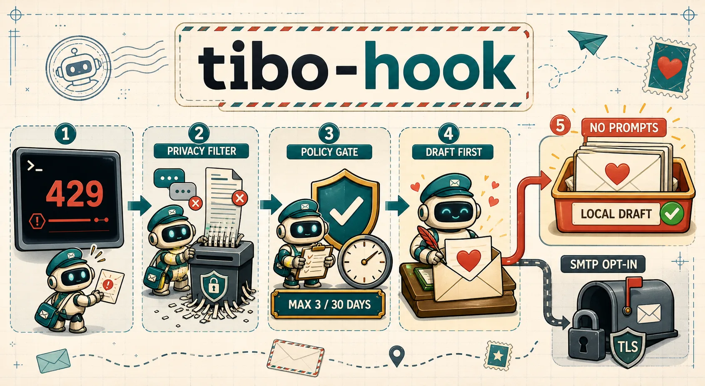

# tibo-hook

**English** | [简体中文](./README.zh-CN.md)



`tibo-hook` is an experimental Codex hook that prepares a sincere, plain-text request for a Codex usage-limit review after it confirms a structured `usage_limit_exceeded` event in a compatible local transcript.

By default, it creates a local `.eml` draft with `0600` permissions. It connects to SMTP only after the user explicitly configures `autoSend=true`, an SMTP server, and a recipient.

> [!IMPORTANT]
> This project is not affiliated with, authorized by, or endorsed by OpenAI, the Codex team, or Tibo. It cannot guarantee additional capacity. It does not bundle, discover, or collect anyone's email address. Use only an address you obtained lawfully and have a legitimate reason to contact. Do not use this project for harassment, bulk email, or policy evasion.

## Status

| Item | v0.1.0 |
|---|---|
| Stability | Experimental |
| Verified Codex version | `0.144.3` (exact match) |
| Supported surfaces | Codex App and interactive Codex CLI |
| Not supported | IDE extension and `codex exec --ephemeral` |
| Default delivery | Draft only, `autoSend=false` |
| Automatic-send limit | Once per reset window; at most 3 messages per rolling 30 days |

The transcript format is not a stable public Hook API. Unknown Codex versions, unknown surfaces, plain-text 429 errors, service overloads, tool errors, and schema drift all fail closed and produce no email. See [SPEC.md](./SPEC.md) for the complete contract and [DESIGN.md](./DESIGN.md) for the implementation design.

## How it works

```text
SessionStart / UserPromptSubmit Hook
                ↓
      local singleton supervisor
                ↓
 version-gated transcript detector
                ↓
 policy + template + durable outbox
                ↓
       .eml draft (default) / SMTP
```

The email path does not call an LLM. Prompts, assistant responses, tool output, complete error text, and transcript content are never inserted into the email.

## Installation

### 1. Prerequisites

- Node.js 20 or later.
- A Codex CLI version that supports `codex plugin`.
- `node` must be available on `PATH` inside the Codex App Hook environment.

```bash
node --version
codex plugin --help
```

### 2. Install from the GitHub marketplace (recommended)

These commands follow the Codex [CLI marketplace installation flow](https://developers.openai.com/plugins/build/plugins#add-a-marketplace-from-the-cli):

```bash
codex plugin marketplace add zxdxjtu/tibo-hook --ref main
codex plugin add tibo-hook@tibo-hook
codex plugin list --marketplace tibo-hook --json
```

`plugin list` should show `pluginId` as `tibo-hook@tibo-hook`, with both `installed` and `enabled` set to `true`.

### 3. Install from local source

```bash
git clone https://github.com/zxdxjtu/tibo-hook.git
cd tibo-hook
npm ci
npm run build
codex plugin marketplace add "$(pwd)"
codex plugin add tibo-hook@tibo-hook
```

In PowerShell, replace `"$(pwd)"` with `(Resolve-Path .).Path`.

### 4. Review the Hooks and initialize

Installation does not automatically trust command Hooks. Start a new Codex task, open `/hooks`, and follow [Hook review and trust](https://learn.chatgpt.com/docs/hooks#review-and-trust-hooks). Confirm that all three commands come from this plugin and point to its bundled runtime before explicitly trusting them:

- `SessionStart`
- `UserPromptSubmit`
- `Stop`

Then invoke the bundled setup skill:

```text
Use $tibo-hook-setup to initialize and validate tibo-hook.
```

Users working from local source can run the same runtime directly:

```bash
node plugins/tibo-hook/dist/tibo-hook.cjs init
node plugins/tibo-hook/dist/tibo-hook.cjs config path
```

The bare `tibo-hook` command is an optional entry point provided by the companion npm package. As of v0.1.0, that package has not been published to npm. Do not install an unverified global package with the same name.

## Configuration

`init` creates `config.json`, the request template, installation keys, and the outbox inside the private `PLUGIN_DATA` directory allocated by Codex. It does not overwrite existing files or write user configuration into the repository.

Minimal draft-only configuration:

```json
{
  "schemaVersion": 1,
  "tiboEmail": "recipient@example.invalid",
  "userEmail": "you@example.invalid",
  "requesterName": "Your Name",
  "useCase": "Describe your real Codex use case in at least 20 characters.",
  "impact": "Explain the concrete impact of the usage limit in at least 20 characters.",
  "feedback": "Share truthful, specific product feedback in at least 20 characters.",
  "templatePath": "templates/request.txt",
  "subjectTemplate": "Request for a Codex usage-limit review — {{requesterName}}",
  "autoSend": false,
  "debug": { "triggerNextPrompt": false },
  "policy": { "maxPerRolling30Days": 3 }
}
```

`example.invalid` is a reserved, non-deliverable example domain and must be replaced. Never commit real email addresses, SMTP configuration, or generated `.eml` files.

Validate, preview, and inspect status:

```bash
tibo-hook validate
tibo-hook preview
tibo-hook status
```

Without the companion CLI, replace `tibo-hook` with:

```bash
node /absolute/path/to/plugins/tibo-hook/dist/tibo-hook.cjs
```

## Optional SMTP delivery

Keeping `autoSend=false` enables detection and draft generation without any SMTP network access.

Automatic delivery permits only these combinations:

- Port `587` with `starttls-required`
- Port `465` with `implicit-tls`

Example:

```json
{
  "autoSend": true,
  "smtp": {
    "host": "smtp.example.invalid",
    "port": 587,
    "security": "starttls-required",
    "username": "your-smtp-user",
    "fromEmail": "you@example.invalid",
    "passwordEnv": "TIBO_HOOK_SMTP_PASSWORD",
    "timeoutMs": 15000
  }
}
```

The password must be stored in the process environment variable named by `passwordEnv`:

```bash
export TIBO_HOOK_SMTP_PASSWORD='your-app-password'
```

Do not place the password in `config.json`, shell history, issues, logs, or screenshots. Restart Codex and the supervisor after changing the environment variable; an already-running supervisor cannot acquire a new environment.

The SMTP self-test sends a real fixed-content message, but the recipient is forcibly restricted to `userEmail`:

```bash
tibo-hook smtp-test --to-self
```

## Debug mode

```bash
tibo-hook debug-next
```

This applies only to the next prompt. It atomically resets the flag, produces a local preview addressed to `userEmail`, does not read a real quota error, never connects to SMTP, and does not consume a reset window or rolling 30-day allowance.

## Updating and uninstalling

Upgrade the Git marketplace, reinstall the plugin, and start a new task to load the new version:

```bash
codex plugin marketplace upgrade tibo-hook
codex plugin add tibo-hook@tibo-hook
```

Uninstall:

```bash
codex plugin remove tibo-hook@tibo-hook
codex plugin marketplace remove tibo-hook
```

Before uninstalling, run `tibo-hook config path` if you need to record the data directory. Plugin data may contain configuration, real email addresses, request text, and drafts. Whether Codex retains this directory depends on current plugin-storage behavior; inspect the exact path before deciding whether to remove it.

## Privacy and security

- No telemetry, analytics service, hosted relay, or recipient discovery is enabled by default.
- The real detector projects only version, surface, model, structured error code, and reset metadata; it does not persist transcript content.
- Logs omit complete email addresses, email bodies, SMTP usernames and passwords, prompts, and transcript paths.
- `.eml` files and configuration necessarily contain plaintext email addresses and user-authored statements. Disk backups, sync software, and other processes running as the same system user may still access them.
- The SMTP server sees the envelope, headers, and body. This is the only business-network destination used by automatic delivery and the self-test.
- With `autoSend=true`, the configured SMTP host receives the password named by `passwordEnv` for authentication. Enable it only when you trust both `PLUGIN_DATA/config.json` and the configured SMTP host.

See [PRIVACY.md](./PRIVACY.md) for details. Report vulnerabilities privately as described in [SECURITY.md](./SECURITY.md). Never paste configurations, emails, or credentials into a public issue.

## Development and verification

```bash
npm ci
npm run check
npm test
npm run verify
```

Tests use redacted JSONL fixtures and injected SMTP transports. They do not intentionally exhaust a real quota or send mail to a real address. The build artifact is `plugins/tibo-hook/dist/tibo-hook.cjs`; third-party licenses are listed in [THIRD_PARTY_NOTICES.md](./THIRD_PARTY_NOTICES.md).

## Contributing

Pull requests should explain behavior changes, privacy impact, and verification results. Adding a compatible Codex version requires a redacted fixture, parser tests, and App/CLI smoke evidence; changing only `compatibility.json` is not sufficient.

## License and disclaimer

The project source is available under the [MIT License](./LICENSE). Third-party components retain their respective licenses.

“OpenAI”, “Codex”, and related marks belong to their respective owners. “Tibo” describes the project's inspiration and a user-configured communication target; it does not imply participation or endorsement. Users are responsible for complying with applicable law, email-provider terms, anti-spam rules, and the recipient's reasonable expectations.
